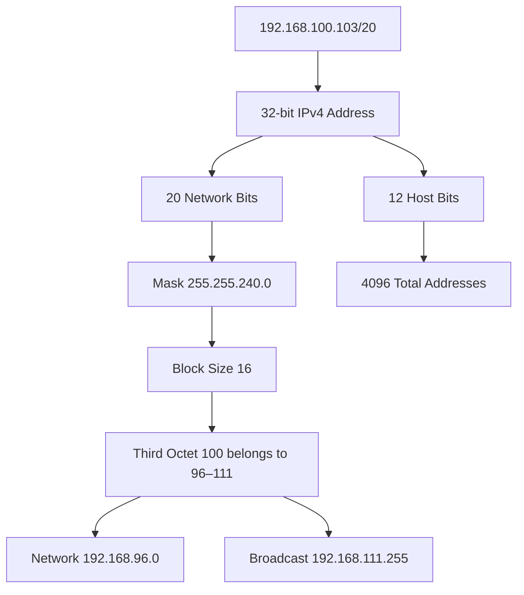
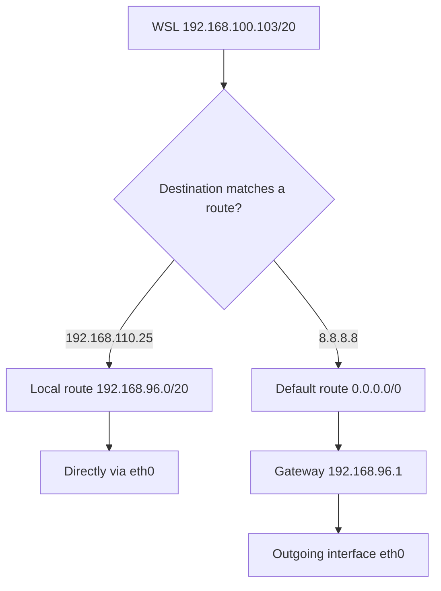
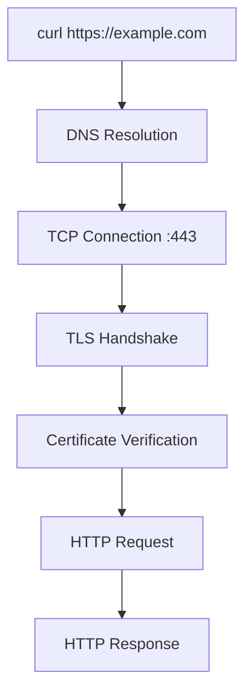
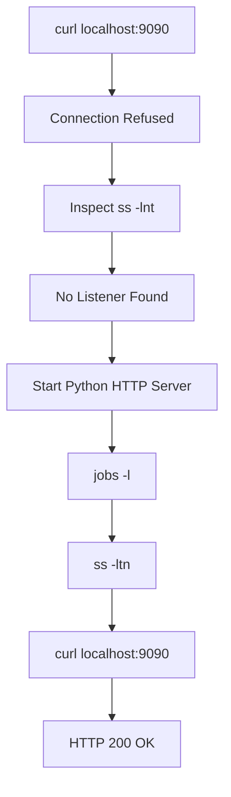
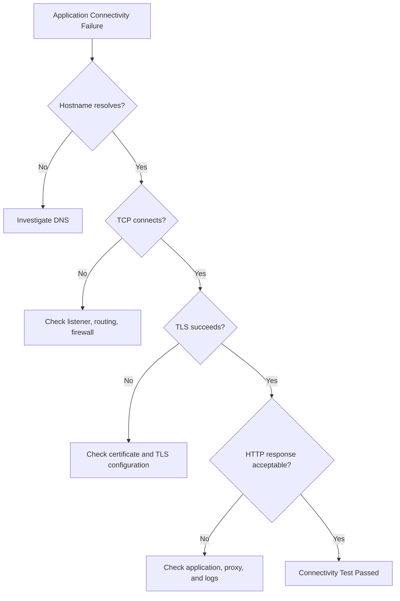

# 🐧 Linux Networking — Practical Notes

**Environment:** WSL Ubuntu 22.04  
**Learning Date:** 14 October 2026  
**Topics:** CIDR, Routing, Gateway, ICMP, DNS basics, TCP, HTTPS, Process and Port Troubleshooting

---

## 1. Networking Fundamentals

Linux networking allows servers, applications, containers, and other devices to communicate.

Important concepts:

- IP Address: Identifies a network interface.
- Subnet: A logical IP address range.
- CIDR: Specifies the network prefix length.
- Subnet Mask: Separates network bits from host bits.
- Default Gateway: Next-hop router used when no more specific route matches.
- DNS: Resolves domain names to addresses.
- TCP: Connection-oriented transport protocol.
- ICMP: Protocol used by ping.
- HTTP/HTTPS: Application-layer communication protocols.

### Network Investigation Commands

```bash
ip link show
ip -4 addr show
ip route show
ip route get 8.8.8.8
```

---

## 2. CIDR and Subnet Calculation

An IPv4 address consists of 32 bits divided into four octets.

Example:

```text
192.168.100.103/20

IPv4 bits     = 32
Network bits  = 20
Host bits     = 32 - 20 = 12
Total IPs     = 2^12 = 4096
Usable hosts  = 4096 - 2 = 4094
```

The usable-host calculation above applies to conventional IPv4 subnets. `/31` and `/32` have special use cases. Cloud platforms such as Azure may reserve additional addresses.

### CIDR Reference Table

| CIDR | Subnet Mask | Total IPs | Conventional Usable Hosts |
|---|---|---:|---:|
| /20 | 255.255.240.0 | 4096 | 4094 |
| /24 | 255.255.255.0 | 256 | 254 |
| /25 | 255.255.255.128 | 128 | 126 |
| /26 | 255.255.255.192 | 64 | 62 |
| /27 | 255.255.255.224 | 32 | 30 |
| /28 | 255.255.255.240 | 16 | 14 |
| /29 | 255.255.255.248 | 8 | 6 |
| /30 | 255.255.255.252 | 4 | 2 |

### Subnet Mask Calculation

Example: `/20`

```text
Network bits = 20

8 + 8 + 4 = 20

First octet:  11111111 = 255
Second octet: 11111111 = 255
Third octet:  11110000 = 240
Fourth octet: 00000000 = 0

Subnet Mask = 255.255.240.0
```

### Block Size Calculation

Formula for the octet where the mask is partially filled:

```text
Block Size = 256 - Subnet Mask Octet
```

For `/20`:

```text
256 - 240 = 16
```

Third-octet blocks:

```text
0–15
16–31
32–47
48–63
64–79
80–95
96–111
112–127
...
240–255
```

### Actual WSL Example

```text
IP Address:       192.168.100.103/20
Subnet Mask:      255.255.240.0
Block Size:       16
Matching Block:   96–111

Network Address:  192.168.96.0
Broadcast:        192.168.111.255

First Usable:     192.168.96.1
Last Usable:      192.168.111.254
```

**Key distinction:**

- Network address = All host bits set to 0.
- Broadcast address = All host bits set to 1.

### CIDR Diagram



---

## 3. Linux Network Interfaces

Command:

```bash
ip -4 addr show
```

Observed WSL interfaces:

| Interface | IPv4 | Purpose |
|---|---|---|
| lo | 127.0.0.1/8 | Loopback |
| eth0 | 192.168.100.103/20 | Main WSL network |
| docker0 | 172.17.0.1/16 | Docker bridge |
| br-9ac9ad2f782a | 192.168.49.1/24 | Docker bridge |

An additional `10.255.255.254/32` address was observed on `lo`.

**Note:** Interface administrative flags and operational state are different. A Docker bridge can show an UP flag while its operational state is DOWN.

---

## 4. Routing and Default Gateway

Command:

```bash
ip route show
```

Actual output:

```text
default via 192.168.96.1 dev eth0 proto kernel
172.17.0.0/16 dev docker0 proto kernel scope link src 172.17.0.1 linkdown
192.168.49.0/24 dev br-9ac9ad2f782a proto kernel scope link src 192.168.49.1 linkdown
192.168.96.0/20 dev eth0 proto kernel scope link src 192.168.100.103
```

### Important Fields

| Field | Meaning |
|---|---|
| default | Fallback route |
| via | Next-hop gateway |
| dev | Outgoing interface |
| src | Preferred source IP |
| scope link | Directly connected destination |
| linkdown | Interface or link unavailable |

### Routing Rule

Linux selects a matching route using longest-prefix matching.

For example:

```text
192.168.96.0/20 → Specific local route
0.0.0.0/0       → Default route
```

The `/20` route is more specific than `/0`.

### Real Route Testing

Local-subnet destination:

```bash
ip route get 192.168.110.25
```

Actual result:

```text
192.168.110.25 dev eth0 src 192.168.100.103 uid 1000
    cache
```

External destination:

```bash
ip route get 8.8.8.8
```

Actual result:

```text
8.8.8.8 via 192.168.96.1 dev eth0 src 192.168.100.103 uid 1000
    cache
```

### Routing Diagram



**Important:** A selected route does not guarantee the destination is reachable.

---

## 5. ICMP and Ping Troubleshooting

Ping tests ICMP Echo Request and Echo Reply communication.

Command:

```bash
ping -c 4 192.168.96.1
```

Actual gateway result:

```text
4 packets transmitted, 0 received, 100% packet loss
```

External IP test:

```bash
ping -c 4 8.8.8.8
```

Actual result:

```text
4 packets transmitted, 4 received, 0% packet loss

rtt min/avg/max/mdev =
31.378/43.240/52.518/8.236 ms
```

### Key Observation

The gateway did not reply to ping, but the external IP did.

This proves that a failed gateway ping does not necessarily mean the gateway or internet connection is down.

Possible explanations include ICMP filtering or virtual networking behavior.

### Ping Output Fields

| Field | Meaning |
|---|---|
| icmp_seq | Request sequence number |
| ttl | Remaining Time To Live |
| time | Round-trip time |
| transmitted | Requests sent |
| received | Replies received |
| packet loss | Percentage of requests without replies |
| rtt avg | Average round-trip time |

---

## 6. HTTP and HTTPS Connectivity Testing

Command:

```bash
curl -I --connect-timeout 5 --max-time 15 https://example.com
```

Actual result:

```text
HTTP/2 200
content-type: text/html; charset=utf-8
server: cloudflare
cf-cache-status: HIT
```

### curl Options

| Option | Purpose |
|---|---|
| -I | Make HEAD request and display headers |
| -i | Include response headers with body |
| -v | Verbose connection diagnostics |
| --connect-timeout 5 | Connection establishment timeout |
| --max-time 15 | Overall operation timeout |

### HTTPS Connection Flow



### Verbose curl

```bash
curl -v -I --connect-timeout 5 --max-time 15 https://example.com
```

Observed diagnostic lines:

```text
* Trying 104.20.23.154:443...
* Connected to example.com (104.20.23.154) port 443
* SSL connection using TLSv1.3 / TLS_AES_256_GCM_SHA384
* SSL certificate verify ok.
* ALPN, server accepted to use h2
> HEAD / HTTP/2
> Host: example.com
< HTTP/2 200
```

### Interpretation

- Trying: curl attempts a TCP connection to the IP and port.
- Connected: TCP connection established.
- TLSv1.3: TLS 1.3 negotiated.
- Certificate verify ok: Certificate verification succeeded.
- ALPN h2: HTTP/2 protocol selected.
- HEAD: HTTP request method.
- HTTP/2 200: Successful HTTP response.

**Important:** Successful ping does not guarantee successful HTTPS.

Also, a TCP connection being established does not guarantee the TLS handshake or HTTP request will succeed.

---

## 7. Linux TCP Socket Investigation

Command:

```bash
ss -lnt
```

Options:

```text
-l  Listening sockets
-n  Numeric ports and addresses
-t  TCP sockets
-p  Process information
```

To identify process owners:

```bash
sudo ss -lntp
```

Observed result:

```text
LISTEN 0 5 0.0.0.0:8080 0.0.0.0:* users:(("python3",pid=22672,fd=3))
```

Meaning:

- Port 8080 was listening.
- The owner was a Python process.
- PID was 22672.
- File descriptor was 3.
- Binding was all local IPv4 interfaces.

### Process Inspection

```bash
ps -fp 22672
```

Actual command:

```text
python3 -m http.server 8080 --bind 0.0.0.0
```

### Important Binding Difference

```text
127.0.0.1:8080 → Localhost-only listener
0.0.0.0:8080   → Listener on all local IPv4 interfaces
```

Binding to all local interfaces does not guarantee access from the internet. Firewall and routing rules still apply.

---

## 8. TCP Connection Refused — Practical Lab

### Step 1: Reproduce Failure

Command:

```bash
curl -I --max-time 5 http://127.0.0.1:9090
```

Actual output:

```text
curl: (7) Failed to connect to 127.0.0.1 port 9090 after 16 ms: Connection refused
```

### Investigation

Previous `ss` output showed no TCP listener on port 9090.

The likely cause was that no process was accepting TCP connections on that port.

**Connection refused** often indicates an active rejection, such as no listening socket or a rejecting firewall.

**Connection timed out** commonly indicates no timely response, potentially due to packet drops, firewall rules, or connectivity problems.

Neither error alone proves a specific root cause in every environment.

### Step 2: Start Server

Command independently constructed during practice:

```bash
python3 -m http.server 9090 --bind 127.0.0.1 &
```

Observed output:

```text
[1] 23856
Serving HTTP on 127.0.0.1 port 9090 ...
```

Meaning:

- Job ID: 1
- PID: 23856
- Port: 9090
- Bind address: 127.0.0.1
- `&`: Execute in background

### Step 3: Verify Background Job

```bash
jobs -l
```

Actual output:

```text
[1]+ 23856 Running python3 -m http.server 9090 --bind 127.0.0.1 &
```

### Step 4: Verify TCP Listener

```bash
ss -ltn
```

Actual result:

```text
LISTEN 0 5 127.0.0.1:9090 0.0.0.0:*
```

### Step 5: Verify HTTP Response

```bash
curl -i --max-time 5 http://127.0.0.1:9090
```

Actual result:

```text
HTTP/1.0 200 OK
Server: SimpleHTTP/0.6 Python/3.10.12
Content-type: text/html; charset=utf-8
Content-Length: 297
```

The server returned a directory listing for the `network-lab` working directory.

### Service Recovery Diagram



### Cleanup

Only stop the lab process after confirming its identity.

Example using the observed PID:

```bash
ps -fp 23856
kill 23856
```

Then verify:

```bash
ss -ltn
```

The specific PID may differ between sessions. Never blindly reuse old PIDs without checking.

---

## 9. Production Troubleshooting Checklist

When an application is unavailable:

1. Reproduce the reported error with curl.
2. Determine whether the failure is DNS, TCP, TLS, or HTTP.
3. Inspect listening sockets using `ss -lnt`.
4. Identify the owning process using `sudo ss -lntp`.
5. Inspect the process using `ps -fp PID`.
6. Inspect relevant service status and logs when necessary.
7. Form a root-cause hypothesis using evidence.
8. Apply the smallest appropriate fix.
9. Repeat the connectivity test.
10. Document the result and prevention measures.

### Diagnostic Flow



---

## 10. Personal Learning Checkpoint

### Completed Practicals

- IPv4 and CIDR calculations
- Subnet mask calculation
- Network and broadcast address calculation
- Routing table inspection
- Direct vs default-gateway routing
- Gateway and external ICMP tests
- HTTPS connectivity testing
- Verbose curl analysis
- TCP listener identification
- Process/PID inspection
- Connection refused reproduction
- Python HTTP service recovery
- HTTP response verification

### Mistakes and Lessons

1. Broadcast address was confused with network address.
   - Network uses first address.
   - Broadcast uses last address.

2. Same-subnet traffic was initially assumed to use the gateway.
   - Directly connected routes can be selected without a gateway.

3. `ping -c 4` was initially interpreted as four bytes.
   - It means four Echo Requests.

4. A listening TCP port was initially assumed to guarantee HTTP success.
   - Process, TCP, TLS, and HTTP require separate verification.

### Current Proficiency (Provisional)

| Dimension | Rating |
|---|---|
| Concept Understanding | 8/10 |
| Independent Command Construction | 8/10 |
| Transfer to New Problems | 7/10 |
| Delayed Retention | Not tested |

Ratings are specific to the completed networking lab, not overall Linux mastery.

### Revision Plan

- Same day: Reconstruct the routing and TCP troubleshooting sequence.
- After 24 hours: Calculate a new subnet without notes.
- After 3 days: Diagnose an unfamiliar connection error.
- After 7 days: Rebuild and troubleshoot a local HTTP service independently.

### Next Mission

**Mission 13 — DNS Troubleshooting**

Topics:

- DNS resolution process
- `getent`
- `dig`
- `/etc/resolv.conf`
- A, AAAA, CNAME, MX, TXT records
- DNS resolution errors
- DNS vs TCP connectivity
- Real DevOps DNS incident simulations

---

## Final Engineering Principle

> Never assume that a running process means a healthy application.
>
> Verify each layer independently: process, socket, transport, security, and application response.

**Learning goal:** Understand, build, troubleshoot, and explain Linux systems independently.
