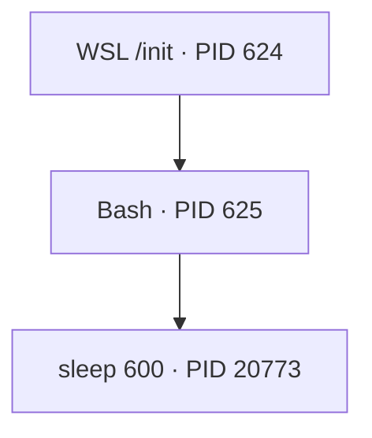
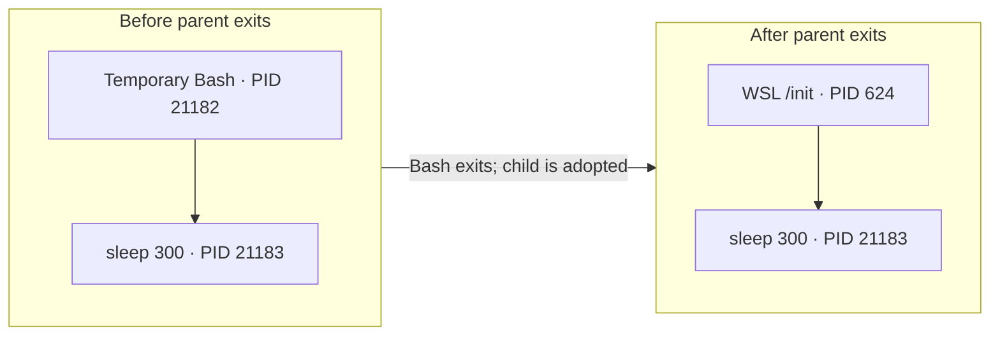
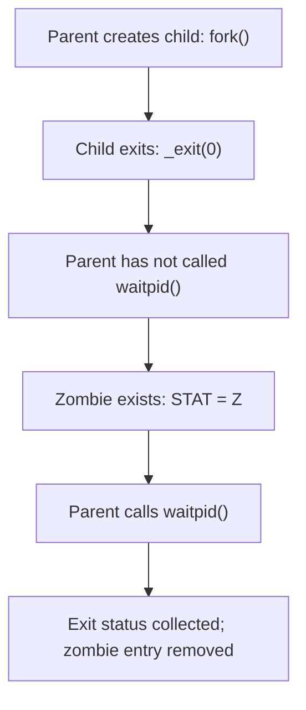

# Linux Process Lifecycle — PID, PPID, Orphan and Zombie Processes

> **Learning lab:** WSL Ubuntu 22.04 · **Focus:** process hierarchy, orphan reparenting, zombie reaping and safe production troubleshooting.
>
> **Evidence note:** PIDs in the observed-output sections are from our actual practice sessions. They are temporary and will differ on another run. The Azure and incident examples are illustrative, not production incidents.

## 1. Learning objectives

After this lab, I can:

- Distinguish a **PID** from a **PPID** and identify a process's parent.
- Read process states in `ps`, including **`S`**, **`Z`** and extra status markers.
- Explain and demonstrate what happens when a parent exits before its child (**orphan**).
- Explain and demonstrate what happens when a child exits before its parent reaps it (**zombie**).
- Verify process relationships and troubleshoot safely without blindly killing services.

## 2. PID, PPID and process hierarchy

- **PID (Process ID):** The identifier Linux assigns to a process while it exists.
- **PPID (Parent Process ID):** The PID of the process currently recorded as its parent.
- A process can be a **child of one process and parent of another** simultaneously.
- A PID is **not a permanent identifier**: after a process exits and is reaped, Linux may reuse the number later.
- Parent-child relationships should be checked with **PPID**, not inferred from whether one PID is numerically larger than another.

### Observed parent–child relationship

We ran `sleep 600 &` in Bash and inspected both the child and parent:

```bash
sleep 600 &
jobs -l
ps -p 20773 -o pid,ppid,user,stat,cmd
ps -p 625 -o pid,ppid,user,stat,cmd
```

Observed while `sleep` was alive:

```text
PID     PPID USER      STAT CMD
20773    625 serverl+  S    sleep 600

PID     PPID USER      STAT CMD
625      624 serverl+  Ss   -bash
```

`serverl+` is how the `USER` field was truncated to fit its display width, **not** the full username.



**Interpretation:** Bash is a child of PID 624 and was the parent of `sleep` PID 20773. The `sleep` process later completed normally.

### Commands to remember

| Command | Purpose |
|---|---|
| `echo $BASHPID` | Show the PID of the current Bash process. |
| `sleep 300 &` | Start a `sleep` process as a background job. |
| `echo $!` | Show the PID of the most recent asynchronous/background job launched by this shell. |
| `jobs -l` | Show the shell's jobs and associated PIDs. |
| `ps -p PID -o pid,ppid,stat,cmd` | Inspect selected process details. Replace `PID` with a real value. |
| `pstree -p` | Display the process hierarchy with PIDs (if `pstree` is installed). |

**Important:** Shell job IDs such as `[1]` are not the same as kernel PIDs such as `20773`.

## 3. Process states and status markers

| `STAT` indicator | Meaning |
|---|---|
| `R` | Running or runnable. |
| `S` | Interruptible sleep (waiting for an event). |
| `D` | Uninterruptible sleep, commonly associated with I/O-related waits. |
| `T` | Stopped, e.g., by job control or a tracing signal. |
| `Z` | Zombie: child exited but has not yet been reaped. |
| `s` | Session leader (additional flag). |
| `+` | Member of the foreground process group (additional flag). |

For example, **`Ss`** describes a sleeping session leader. **`Z+`** means a zombie in the foreground process group. `S` does **not** mean that a process is actively using CPU the whole time.

## 4. Orphan process — parent exits, child survives

An **orphan** is a still-living child whose original parent has exited. Linux changes the child's PPID and reparents it to an appropriate adopter (for example, PID 1 or a designated child subreaper). **The child's PID normally stays the same.** An orphan is not automatically a zombie.

### Lifecycle diagram



### Safe orphan lab

We launched a disposable Bash that created a child and then exited:

```bash
bash -c 'sleep 300 & echo "Parent PID: $BASHPID"; echo "Child PID: $!"'
```

Actual output from one run:

```text
Parent PID: 21182
Child PID: 21183
```

After the temporary Bash exited, we inspected the child and original parent:

```bash
ps -p 21183 -o pid,ppid,stat,cmd
ps -p 21182 -o pid,ppid,stat,cmd
```

Observed:

```text
PID     PPID STAT CMD
21183    624 S    sleep 300

PID     PPID STAT CMD
# No row for PID 21182: temporary Bash already exited.
```

**Conclusion:** `sleep` PID **21183** survived, while its PPID changed from **21182** to **624**. Earlier inspection identified PID 624 as WSL `/init`. This is direct evidence of **orphan reparenting** in this environment.

**Safety:** The experiment used a disposable child Bash; it did not terminate the interactive Bash session. In other Linux setups, the adoptive PPID may be 1 or another designated subreaper, not necessarily 624.

## 5. Zombie process — child exits, parent has not reaped it

A **zombie** is an exited child whose parent has not yet collected its termination status. The child's program is no longer executing; most runtime resources are released, but the kernel retains a small amount of bookkeeping, including exit information, until it is **reaped**.

- A zombie may appear as `STAT = Z` or `Z+`.
- The command may be displayed as `[python3] <defunct>`.
- Sending `kill -9` to the zombie cannot make an already-exited program exit again.
- Parents typically call **`wait()` or `waitpid()`** to collect a child's exit status and remove its zombie entry.
- Many persistent zombies can indicate a buggy parent process and can exhaust process/PID-related capacity; a single short-lived zombie is not automatically an outage.

### Lifecycle diagram



### `fork()` return values

`os.fork()` returns **different values** in the two processes:

| Execution context | Return value from `os.fork()` |
|---|---|
| Parent | The **actual child PID** (positive integer). |
| Child | **`0`**. |
| Error | Python raises an `OSError`. |

This is why `if child_pid == 0:` runs only in the child branch.

### Safe zombie lab script

Create this file in an isolated lab directory, such as `~/tmp/zombie-lab/zombie_lab.py`:

```python
import os
import time

print(f"Parent PID: {os.getpid()}", flush=True)

child_pid = os.fork()

if child_pid == 0:
    print(f"Child PID: {os.getpid()}", flush=True)
    os._exit(0)

print(f"Parent waiting without reaping child {child_pid}", flush=True)
time.sleep(30)
os.waitpid(child_pid, 0)
print("Child reaped successfully", flush=True)
```

**How it works:** The child exits immediately with `_exit(0)`. The parent intentionally delays calling `waitpid()` for 30 seconds, giving us time to inspect the zombie from a second terminal. Afterward, the parent calls `waitpid()` and exits normally. Do not run this test inside a production application process.

#### Observed evidence from Terminal A

```text
$ python3 zombie_lab.py
Parent PID: 21580
Parent waiting without reaping child 21581
Child PID: 21581
Child reaped successfully
```

#### Observed evidence from Terminal B (during the delay)

```text
$ ps -p 21581 -o pid,ppid,stat,cmd
    PID    PPID STAT CMD
  21581   21580 Z+   [python3] <defunct>
```

This directly confirms that the exited child **21581** was still associated with parent **21580** and was a zombie (`Z+`).

#### Observed evidence after reaping

```text
$ ps -p 21581 -o pid,ppid,stat,cmd
    PID    PPID STAT CMD
```

The process row disappeared. Together with the parent's **`Child reaped successfully`** message, this confirms the zombie's entry was reaped.

## 6. Orphan vs zombie — quick comparison

| Property | Orphan | Zombie |
|---|---|---|
| What happened? | Parent exited before the child. | Child exited before its status was collected. |
| Is child still executing/alive? | Yes, the adopted child may continue running or sleeping. | No, it has already terminated. |
| PPID behavior | Changes when Linux reparents the child. | Usually stays associated with parent until it is reaped or reparented. |
| Typical `STAT` | A normal state, e.g. `S` or `R`. | `Z`, possibly with additional markers, e.g. `Z+`. |
| How is it resolved? | Child continues normally under an adopter until it exits. | Parent/adopter collects exit status via a wait operation. |
| Our evidence | PID 21183, PPID changed 21182 → 624. | PID 21581 observed as `Z+`, then disappeared after reaping. |

**Memory trick:**

- **Orphan = parent gone, child alive.**
- **Zombie = child gone, exit status waiting.**

## 7. Production troubleshooting lessons

### Scenario A — A service has many zombies

1. Identify zombies and their parent PIDs using `ps` (for example, inspect `pid`, `ppid`, `stat` and `cmd`).
2. Determine whether a **common parent** is failing to reap child processes.
3. Inspect the service logs, application code and process supervisor; correlate the problem with deployments or crashes.
4. Coordinate a **graceful service restart or code fix** if needed. Avoid indiscriminate `kill -9`, especially on shared production hosts.
5. Verify that the zombie count falls and that the service remains healthy afterward.

### Scenario B — A parent process exits unexpectedly

1. Check whether child processes remain alive and whether their PPIDs changed.
2. Confirm whether the child should continue independently or whether it needs lifecycle supervision.
3. Inspect relevant service manager and application logs.
4. In managed production systems, use proper supervision (`systemd`, container runtimes, Kubernetes controllers, etc.) rather than relying on ad-hoc shells to manage long-running services.

### Important safety notes

- **Never kill a PID simply because it appears in a training example.** Verify the current PID, command, owner and environment first; PIDs are reusable.
- An orphan does **not** necessarily indicate a fault.
- One momentary zombie is not necessarily problematic; **persistent or growing** zombies warrant investigation.
- A zombie is already dead: `kill -9` cannot reap it. Reaping is a responsibility of its parent or adoptive reaper.
- For production incidents, prioritize evidence collection, application impact, service ownership and a controlled recovery plan.

## 8. Interview questions — self-test

1. What is the difference between PID and PPID?
2. Can a Bash process be both a child and a parent? Explain using PIDs 624, 625 and 20773.
3. What happens to a surviving child's PID and PPID when its parent exits?
4. Why might an orphan's new PPID be something other than 1?
5. What does `STAT = Z+` mean?
6. Why does `kill -9` not remove a zombie?
7. What is the purpose of `waitpid()`?
8. What does `os.fork()` return in the parent and in the child?
9. Why must a process be re-verified before signaling a PID seen in an old log?
10. How would you investigate an increasing number of zombie processes in production?

## 9. Lab completion checklist

- [x] Inspect a child process and its parent with `ps`.
- [x] Inspect Bash hierarchy with `pstree`.
- [x] Create a temporary Bash and a background `sleep` child.
- [x] Observe orphan reparenting: child PID 21183, new PPID 624.
- [x] Write and run an isolated Python zombie lab.
- [x] Capture the zombie state: PID 21581, `STAT = Z+`.
- [x] Verify reaping: process row disappeared after `waitpid()`.
- [ ] Copy this document into the Git repository and review it.
- [ ] Commit and push the documentation; verify `git status`.

---

**Key takeaway:** A good Linux engineer reads the *process relationship and lifecycle*, not just the process name. Parent exit leads to **reparenting** of surviving children; child exit without reaping leads to a **zombie** until the exit status is collected.
